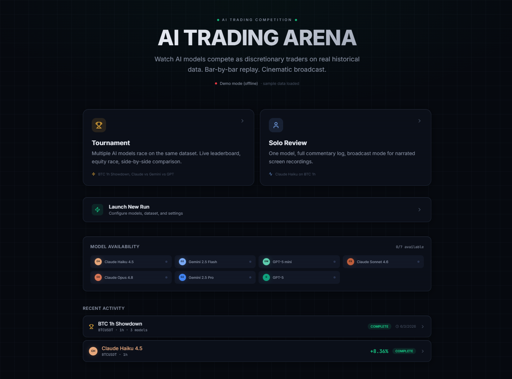
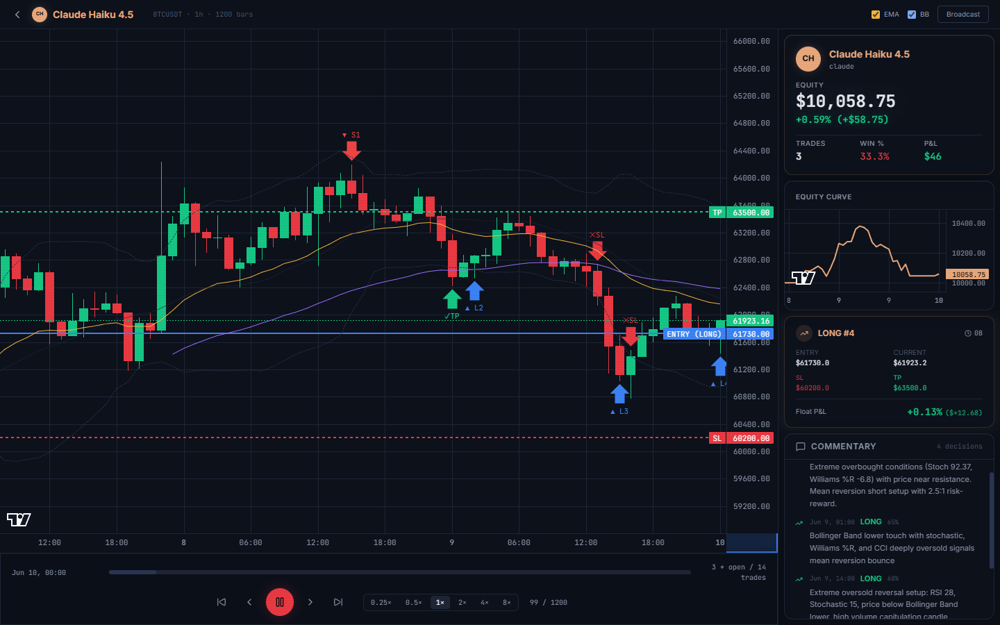

# LLM Trading Arena

Several large language models are given the same historical candles, one bar at a time, with no view of the future, and asked to trade. The market is then forward simulated in pure Python to see whose stop or target got hit first, and the whole thing replays bar by bar in the browser like a broadcast, with a live equity curve, trade markers, a re-sorting leaderboard, and the models' own commentary.

**Live demo: [llm-trading-arena-iota.vercel.app](https://llm-trading-arena-iota.vercel.app)**

The live deployment is the frontend running in replay mode over run records committed to this repo. Read the [What the live demo is and is not](#what-the-live-demo-is-and-is-not) section before drawing conclusions from it.





## Why this is technically interesting

The naive version of this idea is unusable: call an LLM on every bar, wait, and watch a 1200 bar backtest take an hour and cost a fortune. Four decisions make it fast, cheap, and honest instead.

**No lookahead, structurally rather than by promise.** The decision context is a hard slice, `candles[i - lookback + 1 : i + 1]`, built in one place ([backend/engine/context.py](backend/engine/context.py)). Indicators are precomputed over the whole series once with vectorized numpy, then read by index, so an indicator value at bar `i` can never contain information from bar `i + 1`. A backtest that leaks the future is the single most common way this kind of project silently lies, so it is worth checking that slice yourself.

**The model is only called at candidate bars, not every bar.** A deterministic detector proposes setups (EMA cross, RSI extreme, MACD cross, Bollinger touch, swing high or low breakout, engulfing candle) and the model only judges bars where something actually happened. That takes a 1200 bar run from 1200 calls down to roughly 1.5 to 3 times the number of trades. The detector proposes; the model decides. It never places a trade on its own.

**Once the model commits, there is no more inference.** The model returns direction, entry, stop, and target. From there the market is walked forward in plain Python until the stop or the target is touched, with the stop checked first on a bar that touches both, which is the pessimistic and therefore honest assumption. Exit logic in a backtest should never be a language model's opinion.

**Compute once, replay forever.** A run is compiled into a single JSON record holding candles, indicators, trades, per bar equity, and every decision with its rationale. The frontend replays that record with zero further compute, which is why the playback is smooth and scrubbable at eight times speed and why the deployed demo needs no backend at all. The replay store derives every visible number from one integer, the playhead ([frontend/src/lib/replay.ts](frontend/src/lib/replay.ts)).

One more detail that matters more than it sounds: Claude models here run through the local `claude` CLI subscription rather than a metered API key, so a long tournament costs nothing per token. See [backend/adapters/claude_cli.py](backend/adapters/claude_cli.py).

## Architecture

- `backend/data/providers.py`: Binance (public, no key), MetaTrader 5 (a local terminal, optional), and CSV upload, all normalised to one OHLCV shape.
- `backend/data/indicators.py`: vectorized EMA, RSI, ATR, MACD, Bollinger Bands, and swing highs and lows, computed once per series.
- `backend/engine/context.py`: builds the no lookahead decision context, a compact candle table plus an indicator snapshot, and keeps it under roughly two thousand tokens.
- `backend/engine/backtest.py`: the decision loop and the forward simulator. Emits one `RunRecord` per run.
- `backend/engine/arena.py`: tournament orchestration. Models run concurrently with `asyncio.gather` and share one dataset, so the comparison is apples to apples.
- `backend/adapters/`: one adapter per provider behind a single `ModelAdapter` interface, plus `base.py`, which owns the shared prompt and a deliberately forgiving JSON parser that coerces a malformed model reply into a flat decision instead of crashing the run.
- `backend/app.py`: FastAPI. Runs execute as background tasks and stream progress over server sent events, so the UI can watch a run being computed.
- `frontend/src/lib/replay.ts`: a zustand store holding the playhead. Every chart, badge, and leaderboard row is derived state.
- `frontend/src/components/arena/`: the broadcast surface. Candle chart and equity chart on TradingView lightweight-charts, transport controls, leaderboard, commentary log.
- `docs/ARENA_SPEC.md`: the binding contract for all of the above. Schemas, endpoints, and the algorithm, written before the code.

## Run it

Claude works with no API key at all if you have the Claude CLI installed, since the adapter shells out to your local subscription. Every other provider is optional and simply shows as unavailable without a key.

```bash
git clone https://github.com/Hieronymos2077/llm-trading-arena.git
cd llm-trading-arena

cp .env.example .env          # optional, only for non Claude providers
python -m pip install -r requirements.txt
cd frontend && npm install && cd ..

./start.ps1                   # or run the two commands below by hand
```

```bash
python -m uvicorn backend.app:app --port 7077
cd frontend && npm run dev
```

The UI is on http://localhost:7078, the API on http://localhost:7077 with generated docs at `/docs`.

Environment variables, all optional:

| Variable | Purpose |
|---|---|
| `OPENAI_API_KEY` | enables the GPT models |
| `GOOGLE_API_KEY` | enables the Gemini models |
| `OPENROUTER_API_KEY` | enables DeepSeek, Llama, Grok, Mistral, Qwen |
| `CLAUDE_CLI_PATH` | explicit path to the `claude` binary if it is not on PATH |
| `ARENA_BACKEND_PORT`, `ARENA_FRONTEND_PORT` | port overrides |

Start a run from the API directly:

```bash
curl -X POST http://localhost:7077/api/run/solo \
  -H "Content-Type: application/json" \
  -d '{"model_id":"claude-haiku",
       "dataset":{"source":"binance","symbol":"BTCUSDT","timeframe":"1h","limit":1200},
       "config":{"target_trades":14,"risk_per_trade_pct":1.0}}'
```

## What the live demo is and is not

The deployed frontend detects that no backend is reachable, says so in the header, and loads the committed run records instead. Everything you can click there is real code doing real work in the browser: the replay engine, the candle and equity charts, the trade markers, the leaderboard, the transport.

The data behind it is mixed, and the distinction matters.

- The **solo run** is a genuine Claude Haiku run, `run_BTCUSDT_claude-haiku_376eb0fb`: 1200 real Binance BTCUSDT hourly candles, 17 real model calls through the local CLI, 14 trades, 23 minutes of wall clock time. The rationale text under each decision is what the model actually wrote at that bar, and the metrics block is computed from the simulated exits. Two of the 17 calls hit the CLI timeout and the log says so rather than inventing a decision, which is the degraded path working as intended.
- The **tournament fixture** is schema valid sample data generated by [docs/make_fixture.py](docs/make_fixture.py), where a deterministic EMA cross stand in plays the part of each model over real Binance candles. It exists to exercise the schema and the multi model layout. Its commentary is placeholder text, and it is labelled with model names for layout purposes only. Do not read anything into its results.
- **Launching a new run** needs the local backend, so that button will not work on the deployed demo. Clone and run it if you want to watch a live one being computed.

Nothing in this repo should be read as evidence that any model can trade profitably. The real solo run happens to close at plus 8.36 percent with a 50 percent win rate over 14 trades, and that number means almost nothing: 14 trades on one instrument over one 50 day window is well inside the range of luck. Treat it as proof that the pipeline runs end to end, not as a result.

## Deliberately out of scope

- Live trading and broker integration. This reads historical candles and simulates. There is no order router and no broker credential anywhere.
- Fees, funding, slippage, and partial fills. Entries fill at the next bar open and exits fill at the stop or target price exactly. A real edge estimate would need all of that; a model comparison does not, as long as every model gets the same idealised treatment.
- Intrabar resolution. Bars are OHLC only, so when a single bar touches both the stop and the target the stop is assumed to have hit first. Pessimistic on purpose.
- Statistical significance. Twenty or thirty trades on one instrument tells you almost nothing about a model. Fixing that means many symbols, many periods, and repeated seeds, which is a different and much larger project.
- Authentication and multi user support. This is a single user local tool with a deployed read only replay.
